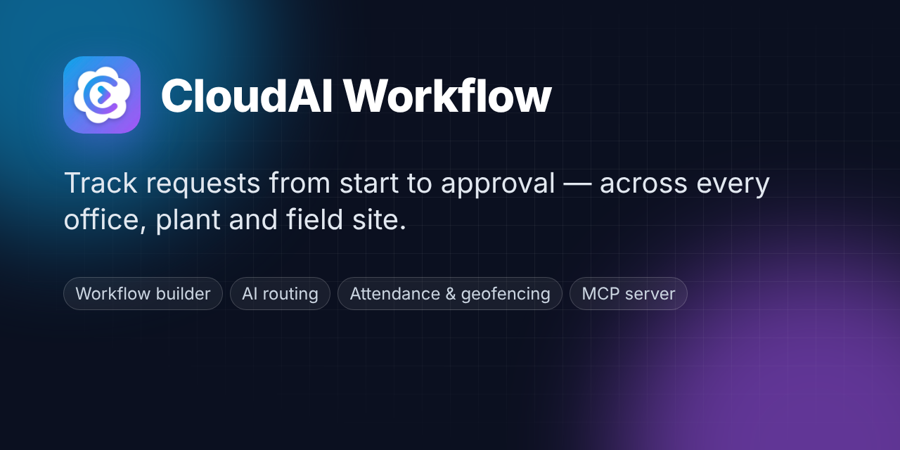
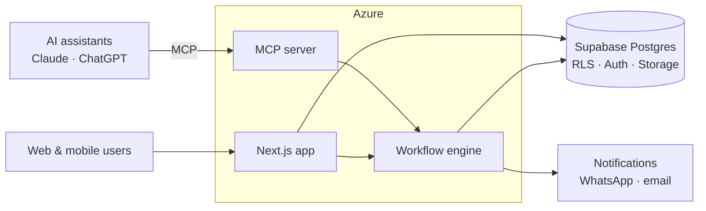

  

  
  
  
  
  
  
  

# CloudAI Workflow

**Track requests from start to approval — across every office, plant and field site.**

CloudAI Workflow gives growing, multi-site businesses one place to assign work, see what's waiting for approval, and manage attendance across locations. Every capability shares the same data, permissions and workflow engine, so approvals, attendance, field work and payroll readiness stay connected.

> This repository is the public overview of the product. The application source is private. Founders, investors and program reviewers can request a code walkthrough — see [Contact](#contact).

## Why it exists

Operations in multi-site businesses (distribution, manufacturing, services) still run on WhatsApp threads, spreadsheets and memory. Requests get lost between sites, nobody knows who owns the next step, and payroll is assembled by hand from attendance registers.

CloudAI Workflow started as the internal operating system for a two-firm B2B distribution business in Surat and Kolkata, and is being productised for other teams with the same problems.

## What it does

| Area | Capabilities |
|---|---|
| **Workflow builder** | Multi-step processes with a doer, deadline and start condition per step; branching on form answers and approval outcomes; backups and fallbacks when someone is away |
| **Approvals & escalations** | Approve / reject / send back for rework, SLA timers, automatic escalation, bottleneck detection |
| **AI routing** | Incoming requests routed to the right person or group; delays and stuck work surfaced automatically |
| **Form engine** | Published forms that start workflows; responses become trackable records |
| **Task tracking** | One-off and recurring tasks (daily → yearly), ownership and overdue views |
| **Attendance & geofencing** | Location-verified check-ins, late marks, leave and missed punches across sites |
| **Payroll handoff** | Attendance, leave and overtime reviewed and exported for payroll |
| **Ops modules** | Vendors, purchasing / PO lifecycle, BOM, projects |
| **Multi-company & sites** | Several companies and locations under role-based access |
| **Dashboards & analytics** | Flow health, cost of delay, in-flight work and workflow analytics |

Example flows that ship as templates: *invoice → payment*, *new-hire readiness*, *purchase request → PO*, *expense approval*.

## AI-native by design: the MCP server

CloudAI Workflow exposes a [Model Context Protocol](https://modelcontextprotocol.io) server, so AI assistants such as Claude and ChatGPT can operate a company's workflows directly — with guardrails.

| Tool group | Examples |
|---|---|
| Forms | `list_forms`, `get_form_schema`, `create_form`, `submit_form_response`, `get_form_responses` |
| Workflow design | `create_workflow` (drafts by default), `add_workflow_step`, `update_workflow_step`, `connect_workflows`, `activate_workflow` |
| Tasks | `create_scheduled_task`, `list_tasks`, `summarize_tasks`, `summarize_task_bottlenecks` |
| Records & tracing | `list_workflow_records`, `get_workflow_record`, `trace_business_object` |
| Health & diagnosis | `scan_workflow_health`, `diagnose_workflow_blocker`, `draft_workflow_improvements` |
| Safe fixes | `plan_workflow_safe_fixes`, `safe_fix_workflow_tasks`, `safe_escalate_workflow_approval`, `safe_retry_workflow_task` |

**Guardrails:** new workflows are created as drafts; every "safe fix" is a dry run unless explicitly applied; definition changes require explicit confirmation and admin / owner scope; all agent activity is logged and auditable.

## Architecture (high level)

- **Frontend & API:** TypeScript, Next.js, React
- **Data:** Supabase (Postgres with row-level security, auth, file storage)
- **Hosting:** Microsoft Azure
- **AI:** Claude and OpenAI models; MCP server for agent access

## Status

- Live at [cloudaiworkflow.com](https://cloudaiworkflow.com), shaped around the real operations of the founder's own distribution business (two firms, ~155 business customers, ~47 brokers)
- Taking demo requests from operations teams — [book a 20-minute walkthrough](https://cloudaiworkflow.com)

## Contact

- Website: [cloudaiworkflow.com](https://cloudaiworkflow.com)
- Founder: [Harshit Jain](https://github.com/rkstudiof-cloud) · [LinkedIn](https://www.linkedin.com/in/harshitjain96)
